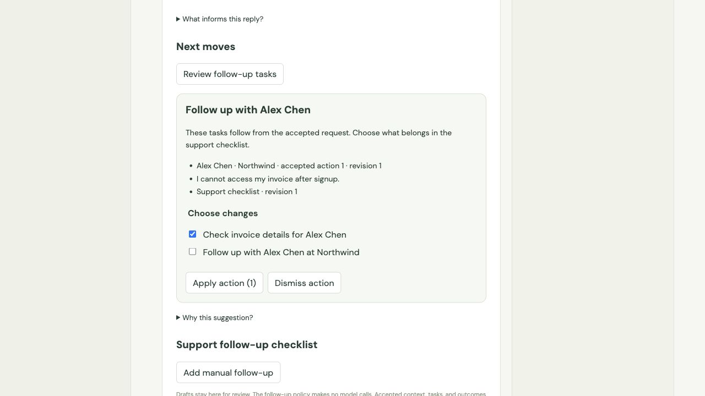
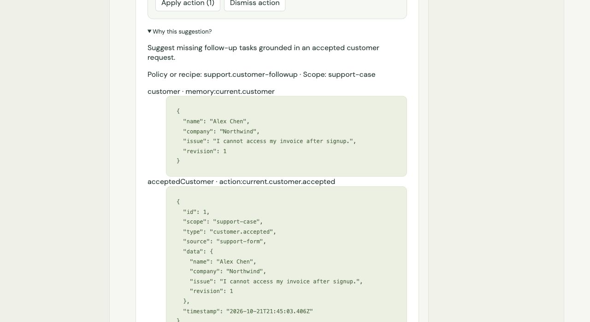

# AI Components Playground

An independent React + TypeScript app for trying AI Components in ordinary workflows. It consumes
`@ai-components/react` as a packaged dependency, with no source aliases, symlinks, or unpublished
GitHub branch installation required.

## Run

Use Node 22.12+ (or a current supported Node release).

```sh
npm ci
npm run dev
```

Open [the local playground](http://127.0.0.1:5180). Mock mode works immediately without an API key.
Sample outputs are deterministic fixtures, not live AI. The app includes all 13 examples: search,
writing, autocomplete, semantic select, form autofill, tags, filters, rewrite actions, dates,
field mapping, multi-select, workflow memory, and change previews.

## Try these flows

### Shared context between controls

1. Open **Workflow memory**.
2. Enter `Name: Alex Chen` and `Company: Northwind` on separate lines in Customer details.
3. Click **Suggest field values**, then **Apply values**.
4. Click **Shorten** below the separate reply field. The proposed reply borrows the accepted name
   and company; the original field stays unchanged until **Use rewrite**.
5. Expand **Inspect assembled request** to see selected memory, action provenance, and downstream-use hints.

### Review the next step of a form

1. Open **Change preview** and click **Suggest next steps**.
2. Uncheck **Priority**, then click **Apply selected (2)**.
3. Category and reply change together; priority remains Normal.
4. Click **Undo AI changes** to restore the accepted batch.
5. Apply another batch, manually edit an affected field, and see that undo becomes unavailable.

The right-hand shared configuration panel controls inherited prompts and enables/disables AI.
Mocks return fixed examples; arbitrary prompt engineering needs a live backend.

## Use GPT-6 Luna

A local server adapter is included for **`gpt-6-luna`**, using the OpenAI Responses API. The API key
stays in the Vite server process and is never sent to the browser or included in the frontend build.

```sh
cp .env.example .env.local
```

Paste your key into `.env.local`:

```env
OPENAI_API_KEY=your-key-here
OPENAI_MODEL=gpt-6-luna
```

Restart `npm run dev`, open the playground, and enable **Use /api/ai endpoint** in the shared
configuration panel. The panel shows the configured model and whether a key is present. Mock mode
remains the default so opening the app does not trigger paid requests.

Live actions incur OpenAI API charges. Luna's standard short-context text rates, checked October 20,
2026, are $0.10 per million input tokens and $0.50 per million output tokens. At 1,000 input and
200 billed output tokens per action, 1,000 actions would cost approximately $0.20 (excluding cache,
tools, and other adjustments). See [current model pricing](https://developers.openai.com/api/docs/models/gpt-6-luna).
Autocomplete may call the model as you type; disable **AI capabilities** or use mock mode when you
want to experiment without paid calls. The adapter uses reasoning effort `none`, caps each response
at 2,048 output tokens, and disables response storage with `store: false`.

Structured outputs cover forms, selections, search/filter criteria, dates, mappings, and multi-field
suggestions. Writing and autocomplete return plain text. Server input limits, same-origin localhost
checks, cancellation, a 45-second timeout, and a four-request concurrency limit are included. This
is a local testing adapter; add deployment authentication and rate limits before hosting it publicly.
The local API also works with `npm run preview`; a static-only deployment needs a separate backend.

### Bring another backend

Set `AI_BACKEND_URL=http://127.0.0.1:3000` in `.env.local` to override the OpenAI adapter in development.
That backend should serve `POST /api/ai`, accepting the library's `AIRequest` and returning `AIResponse`.
The proxy is development-only. The library README bundled in the dependency documents the request
and response contracts. Never put secrets in `VITE_*` variables or commit `.env.local`.

## Library snapshot and updates

`vendor/ai-components-react-045ec1b.tgz` contains the library build from commit
`045ec1b7cb272d7ed9fde5b7d665cd026adc1b2b`, including
[shared memory #8](https://github.com/AndrewTaoWen/AI-Components/pull/8) and
[reviewable suggestions #9](https://github.com/AndrewTaoWen/AI-Components/pull/9).
These features do not need to be merged or published to npm to test them here.
The tarball includes the library's MIT license and README; only the built package is vendored.

After editing a local library checkout (install its dependencies first), refresh the package:

```sh
# Defaults to a sibling ../AI-Components checkout:
npm run update:library
# Or supply a path:
npm run update:library -- /absolute/path/to/AI-Components
npm test
npm run build
```

The script runs the library's `npm pack` build, adds a content-addressed tarball to `vendor`,
updates the dependency and lockfile, and installs it. Commit all three together to share the update.
It does not automatically sync future demo source changes into this app.

## Checks

```sh
npm test
npm run build
npm run format:check
```

Consumer integration tests exercise shared memory and selective acceptance/undo against the packaged
library. GitHub Actions runs the same checks. `npm run preview` serves the production frontend build
on port 5180; mock mode also works there.

## Support workflow: a second application of the shared primitives

Select **Support workflow** in the playground. Accept a customer/company/request, use **Help me
write → Generate draft → Use draft** to review a grounded reply, and open **Review follow-up tasks**.
Choose task additions, apply, dismiss, or undo before subsequent edits. Adding a manual follow-up
while reviewing exercises revision rejection. The reply and next-move inspectors show selected
customer facts, accepted actions, task revisions, and expected downstream use.

This example uses the same packaged `createPersistentAIMemory`, prompt recipes, `useAIPrediction`,
`useAIAction`, `AIActionReview`, and `AIContextInspector` as Folio. The support policy lives in
`demo/support-policy.ts`; it is independent of Folio's notes/checklist rules. Accepted customer data,
reply text, task state, and outcomes persist under the dedicated browser key
`ai-components-playground:support:v1`. No key is stored there. Pending execution/undo controls live
in the mounted hook; the example's single-tab revision checks simulate an application transaction.
A production support app needs an authoritative backend with authorization, atomic revisions and
durable idempotency. The local prediction policy makes no model call; explicit writing assistance
uses whichever mock/live transport the playground has selected. Mock remains the default.




